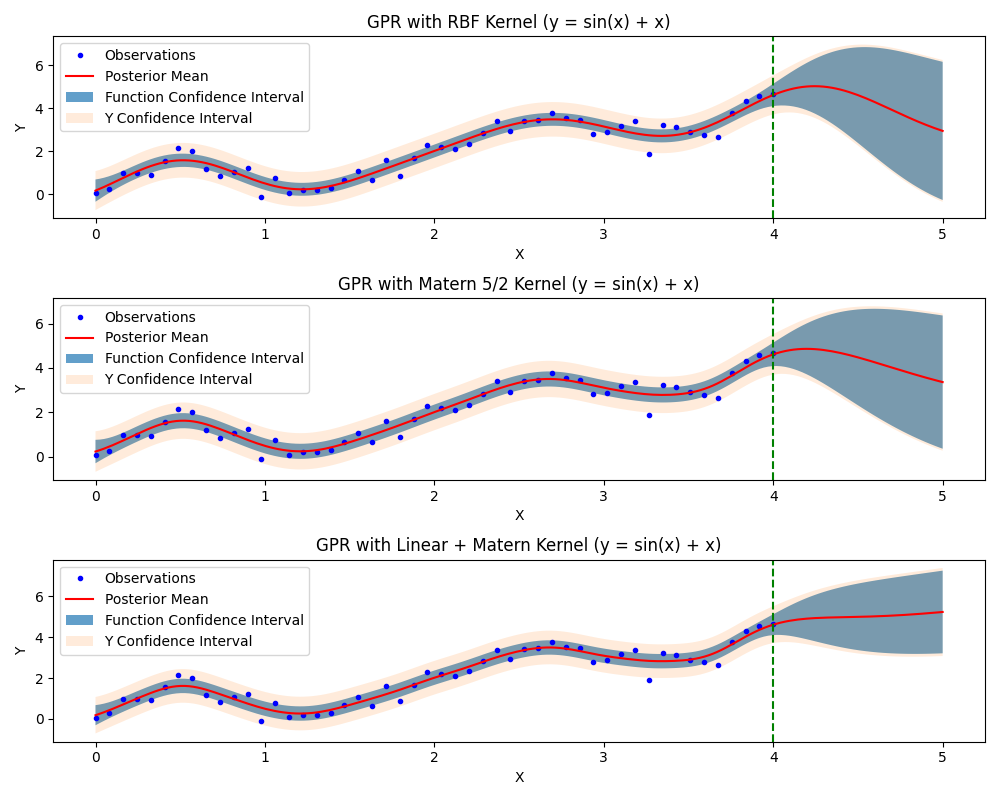
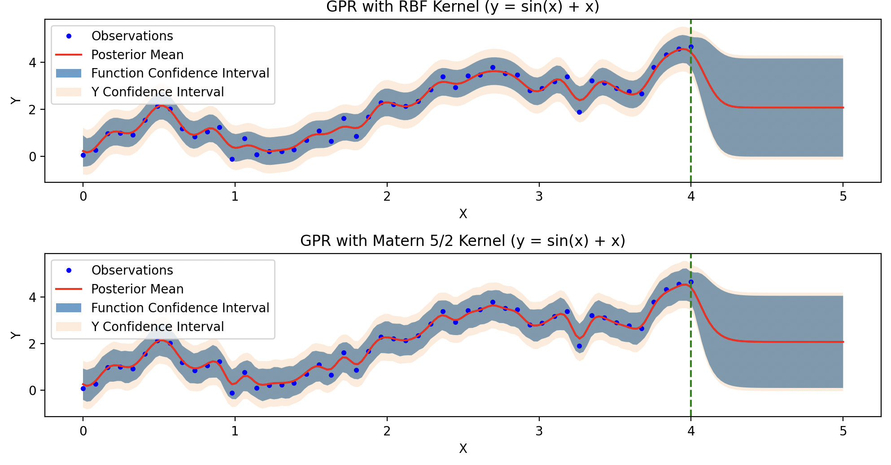

# Purpose:
Compare performance of conventional CBFs vs. CBFs learned via Gaussian Processes. 
Incorporate "smart polling" into learning-based GP-CBFs, intelligently selecting a next point to explore by choosing a nearby point of high covariance.

Paper on GIBO: https://arxiv.org/pdf/2106.11899

# 10/13: Acquisition-function benchmark (in progress)
Compare vanilla GIBO, random querying, and λ-weighted acquisition (ours) as the gradient learner for a
GP-learned HOCBF on a 2-DOF arm (θ₁ ≤ 150°). Full metric definitions: [metrics_to_track.md](metrics_to_track.md).

**Sweep:** σₙ ∈ {0.05, 0.2, 0.5} × M ∈ {1, 2} × 5 Sobol θ₀ × 3 paired seeds (+ oracle baseline) = 315 runs.

## Metrics (brief — full definitions in [metrics_to_track.md](metrics_to_track.md))
Each run logs ~22 fields per step (`steps.npz`) and ~28 summary metrics (`summary.json`).
The true gradient for this task is known (∇h = [−1, 0]), so the gradient estimate can be graded directly.

| Category | Metrics | Question it answers |
|---|---|---|
| Safety | # violation steps, min h, max violation depth | Did the arm cross θ_max, and by how much? |
| Gradient learning **[main]** | ‖μ_∇ − ∇h‖, angle error, √tr Σ_∇ (mean, AUC), 2σ coverage | How accurate is the slope estimate, how fast does its uncertainty shrink, and is that uncertainty honest? |
| Value learning | h_std, \|μ_h − h\|, 2σ coverage | Is h_safe = μ − 2σ actually below the true h? (Similar across algorithms: h is measured at θ_t every step.) |
| Conservatism | intervention rate, boundary gap, tracking RMSE, **excess gap vs. oracle** | How much tracking performance does safety cost, and how much of that is due to *learning* h? |
| Queries | offset / ℓ, fraction on box edge, fraction in unsafe region | Where does each acquisition put its points? |
| Compute | runtime, acquisition time per step | Is a better acquisition also more expensive? |

The **oracle** runs the same CBF with the true h and ∇h (no GP, no queries). Comparing against it separates the
conservatism caused by learning from the conservatism built into the CBF design (γ, α, class-K).

## Running the Monte Carlo sweep
The sweep axes live in `research/config.py → SweepConfig`; every other constant (dt, ℓ, σ², CBF gains, …) is in the
other dataclasses there, and each run's exact settings are saved to its `config.json`.

| Axis | Default values |
|---|---|
| `algos` | gibo, random, lambda (+ oracle if `include_oracle=True`) |
| `noise_stds` | 0.05, 0.2, 0.5 (sensor noise std; the GP noise follows it) |
| `Ms` | 1, 2 (queries per step; M = 4 ≈ 1 min/run) |
| `theta0_offsets` | 5 scrambled-Sobol offsets from r(0), ±0.5 rad |
| `seeds` | 0, 1, 2 (paired: the same seed gives every algorithm the same sensor noise) |

```bash
cd research
python run_sweep.py --dry-run                        # list the runs that would execute
python run_sweep.py --max-runs 8 --end-time 1.0      # smoke test (~6 s): all algorithms, short sims
MPLBACKEND=Agg python run_sweep.py                   # full sweep (315 runs, ~15–20 min)
python run_sweep.py --workers 4                      # fewer workers while using the machine
```
To change the sweep, edit the `SweepConfig` tuples (e.g. `Ms = (1, 2, 4)`) and rerun.
To run a single configuration with plots: `python GIBO_Robotic_Manipulator.py` (uses `RunConfig()` defaults).

**Output:** `outputs/sweep_<YYYY-mm-dd_HHMMSS>/`
- `index.csv`: one row per run (config fields + summary metrics), rewritten after every run, so it survives interruptions
- `<algo>_<optim>_M<M>_n<noise>_th<k>_s<seed>/`: `config.json` (written at start, with git commit), `steps.npz`, `summary.json`
- A run that crashes (e.g. solver failure) is recorded with `status = "failed: …"` and its partial log; the sweep continues.

Commit before a sweep: `config.json` records the git commit, and a `dirty: true` flag means the code can't be recovered exactly.

## How the parallel sweep works (`research/run_sweep.py`)
- **Processes, not threads.** Python's Global Interpreter Lock (GIL) lets only one thread per interpreter run Python
  code at a time. The simulation loop is mostly Python, so threads wouldn't run in parallel. Each worker is a separate
  Python process with its own interpreter, GIL, and memory (~0.3–0.4 GB each, mostly torch/gpytorch/cvxpy).
- **One main process + a Pool of workers.** The main process builds all run configs (`SweepConfig().runs()`), pairs each with
  its output folder, and hands them to a `multiprocessing.Pool`. It never simulates; it only collects results and writes `index.csv`.
- **Workers default to 80% of the cores**, rounded down (8 on a 10-core Mac). Override with `--workers N`.
- **Data passing.** Each job sends only `(RunConfig, run_dir)` to a worker (pickled). The worker builds the arm, GP, and logger
  itself, writes `steps.npz` to disk, and sends back only a flat summary row.
- **`imap_unordered`** returns results as they finish (live progress + crash-safe index). Runs are sorted longest-first
  (M = 2 → M = 1 → oracle) so no worker is left with a long run at the end.
- **`spawn` start method.** Each worker is a fresh interpreter that re-imports the script, so the
  `if __name__ == "__main__":` guard is required (otherwise every worker would start its own sweep).
- **`maxtasksperchild=1`.** Each worker does one run and exits, so memory is returned to the OS after every run
  (no build-up; ~3 GB flat peak with 8 workers). Cost: ~2–3 s of re-imports per run.
- **`torch.set_num_threads(1)` per worker.** Prevents oversubscription (8 processes × 10 torch threads on 10 cores).

**Fixes this round:** GP hyperparameters tied to the sensor noise and derived from the trajectory (ℓ = 1.0, σ² = 11.8);
σ²/ℓ² prior in Σ_∇; a single noisy Gram matrix for every GP computation; exact Cholesky above 800 points;
exact O(n²)-per-candidate acquisition (~22× faster).
# 4/05: Zero-noise CBF vs noisy CBF vs learned-CBF under varying simulated sensor noise conditions.


# 3/24: Conventional CBF performance under noise:


# Stage 4 (GIBO)


 - GIBO allows us to poll points of high covariance to gain information about our function more effectively.
 - However, polling becomes locally "Trapped" with small step sizes


# Stage 1: Basic GP regression implementation (Done)
GP regression on 1D function.
Implement experiments with at least 3 kernels (SE, Matern kernels).
For each kernel, fit hyperparameters, then compare the posterior mean and predictive variance.

Deliverables/Notes: 
 - Plot is under GP_Example_Plots. ( GP_Example_Plots/Stage1_Plots.png ) 
 - We saw strongest performance from Linear + Matern (measured by lowest loss). This makes sense as the linear kernel accounts for the linear bias in our underlying function.


Kernel smoothness.
 - matern 5/2 is twice differentiable, while Squared exponential is infinitely differentiable. In the image below, I cranked up the rate parameter of the initial linear scale. This shows that Matern 5/2 was much noisier around the edges as compared to the SE kernel. This seems to imply that infinitely differentiable kernels will have less noise and be more smooth.
 - Another Note: we do see that final loss of Matern 5/2 is slightly higher, indicating worse performance. 
 


# NOTES
 - GIBO tends to get Stuck in local regions. We can shift this by changing the step size that theta t+1 is updated by, but this seemed to be a recurring issue.
